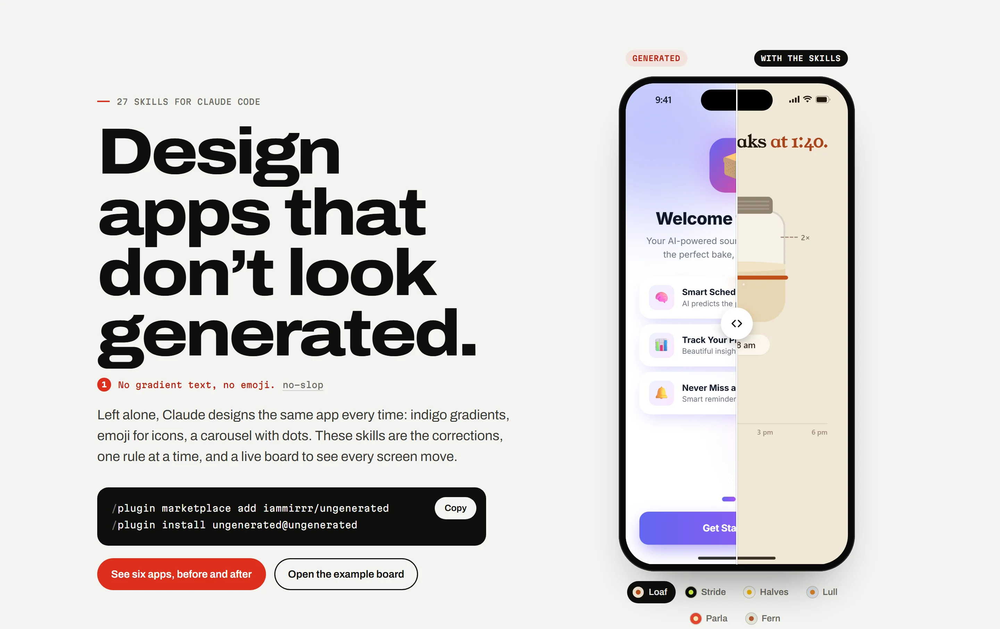
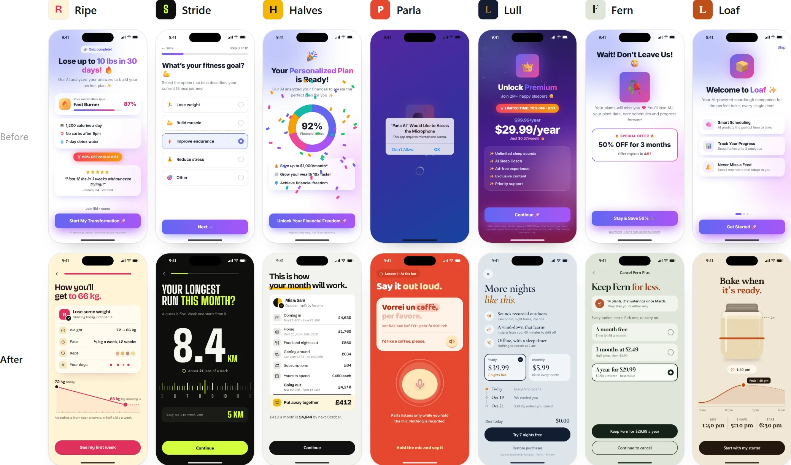
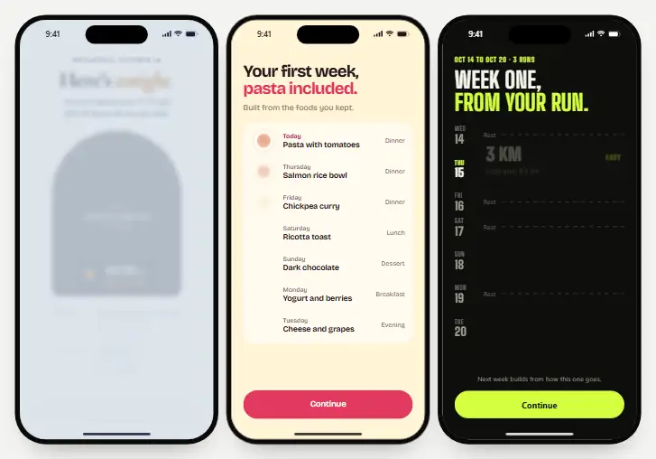
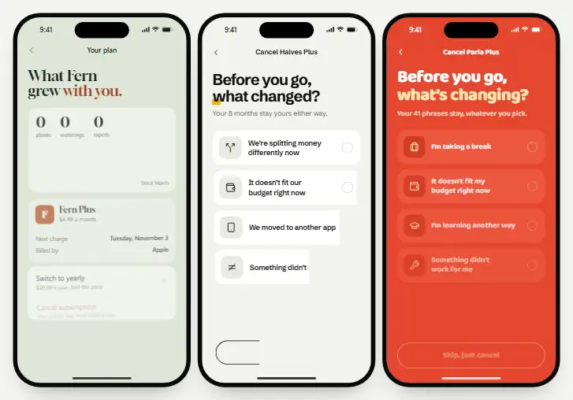
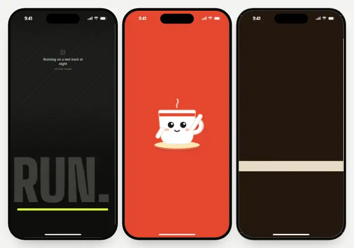
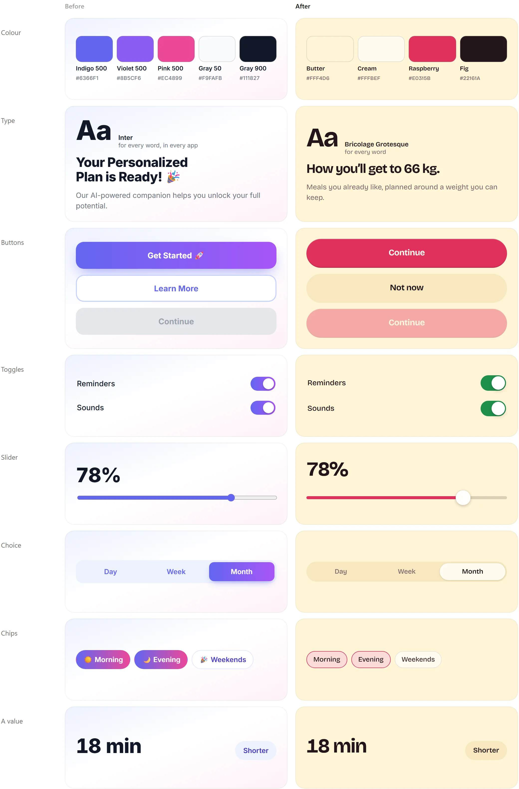
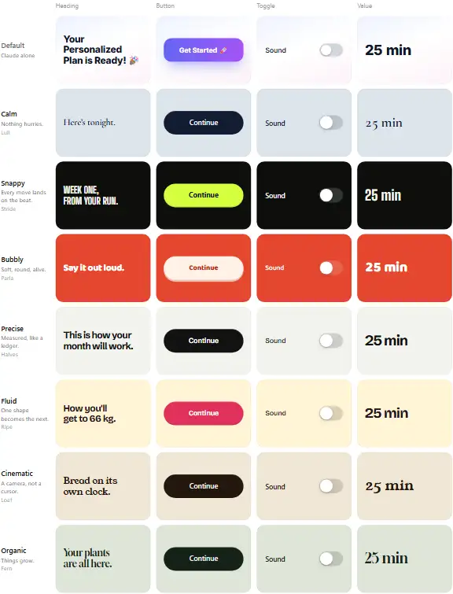
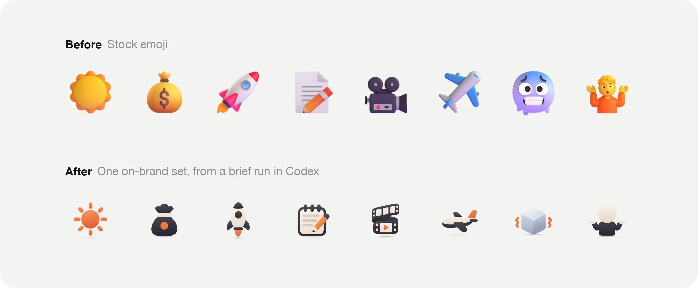
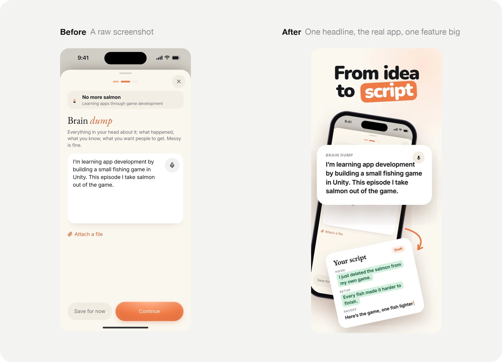
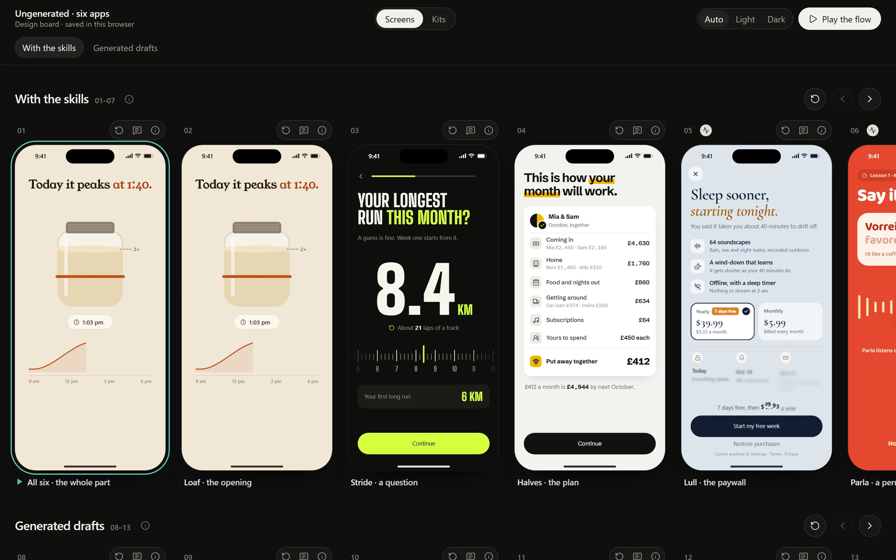

<a href="https://iammirrr.github.io/ungenerated/"></a>

# Ungenerated

Skills for Claude Code that take a mobile app from the first idea to the App Store without looking
generated: the kit, the motion, every flow on a live board, a no-slop review, on-brand icons, the
store listing, and nine audits before launch.

**[See the projects](https://iammirrr.github.io/ungenerated/)** · [Install](#install) · [The skills](#the-skills)

## Same brief, twice



Above, Claude alone: seven apps that look like one. Below, the same seven with the skills.

## Seven projects

Each project page plays every flow live, shows the kit part by part, and gives the ChatGPT prompts
for its pictures.

| Project | | Motion | Flows |
|---|---|---|---|
| [Ripe](https://iammirrr.github.io/ungenerated/projects/ripe.html) | Diet | Fluid | Questions to a plan, the paywall |
| [Stride](https://iammirrr.github.io/ungenerated/projects/stride.html) | Running | Snappy | The opening, questions to week one, the paywall |
| [Halves](https://iammirrr.github.io/ungenerated/projects/halves.html) | Money for two | Precise | Questions to the month, leaving |
| [Parla](https://iammirrr.github.io/ungenerated/projects/parla.html) | Language | Bubbly | The opening, the microphone, leaving |
| [Lull](https://iammirrr.github.io/ungenerated/projects/lull.html) | Sleep | Calm | The paywall |
| [Fern](https://iammirrr.github.io/ungenerated/projects/fern.html) | Plant care | Organic | The first plant, leaving |
| [Loaf](https://iammirrr.github.io/ungenerated/projects/loaf.html) | Baking | Cinematic | The opening, the first bake |



Three paywalls: Lull, Ripe, Stride.



Three ways out: Fern, Halves, Parla.



Three openings: Stride, Parla, Loaf.

## The kit, part by part



Left, the kit Claude uses for every app. Right, Ripe’s, made by [`ungenerated-foundation`](skills/ungenerated-foundation/SKILL.md)
before any screen.

## Seven ways to move



[`ungenerated-motion`](skills/ungenerated-motion/SKILL.md): one line on the board, `style: 'calm'`, and every
heading, press, toggle and value moves that way.

## Icons



[`ungenerated-icons`](skills/ungenerated-icons/SKILL.md) lists every icon the app draws, keeps real
brands as their original artwork, offers a few styles drawn from the brand, then writes one brief an
image model (Codex or ChatGPT) runs icon by icon. These are Comma's.

## The store



[`ungenerated-store`](skills/ungenerated-store/SKILL.md): keywords researched with
[RespectASO](https://github.com/respectlytics/respectaso), then screenshots composed by hand, the
preview trailer, and the header and search-result art of Apple's new creative assets. Comma's, again.

## What the audits catch

| Before | After |
|---|---|
| `subscribed` logged when someone closes Apple's sheet | The result is logged: trial, active, closed or failed |
| A cancel screen that marks the phone "cancelled" while Apple keeps billing | Apple's own cancel sheet; the status read back from the server |
| A one-time offer that falls back to the full-price product | The offer product only, shown only to accounts that can still get it |
| A usage screen with its own numbers | The usage screen reads the same limits the server enforces |
| A screen nothing navigates to, shipped for months | Listed with its file and line, then deleted on the owner's yes |
| A paywall with no Terms or Privacy link (App Review 3.1.2) | Caught before submission, with draft review notes |

Each line is a real bug from a real app. [`ungenerated-audit`](skills/ungenerated-audit/SKILL.md)
runs all eight audits and writes one ranked report; nothing changes until the owner approves.

## Install

In Claude Code:

```
/plugin marketplace add iammirrr/ungenerated
/plugin install ungenerated@ungenerated
```

Or copy the folders you want from `skills/` into `~/.claude/skills/` (all projects) or
`.claude/skills/` (one project). Then ask for “the paywall for my sleep app”, “icons for my app”,
“keywords for my listing” or “audit before launch”, and Claude picks the skill.

## The skills

Each skill is a short `SKILL.md` of numbered steps, the hard rules with their reasons, and a table
of which reference to read when. Every skill has a `references/lessons.md`: what we learned making
real apps, and why.

### Design

| Skill | What it does |
|---|---|
| [`ungenerated-foundation`](skills/ungenerated-foundation/SKILL.md) | Start here. The concept, research of real apps, the kit worked out with you, line icons, real app icons, copy that sounds like a person. |
| [`ungenerated-motion`](skills/ungenerated-motion/SKILL.md) | Screen motion: a style picked side by side, springs, one hero that travels, controls that feel physical, gestures, the character. |
| [`ungenerated-flows`](skills/ungenerated-flows/SKILL.md) | The live board and every flow on it in order, from the opening to the cancel flow, then the native app. |
| [`ungenerated-review`](skills/ungenerated-review/SKILL.md) | The no-slop gate: every AI tell as a named check, real screenshots, accessibility, the review round. |

### Icons and the store

| Skill | What it does |
|---|---|
| [`ungenerated-icons`](skills/ungenerated-icons/SKILL.md) | On-brand icons and the app icon, from a brief for Codex or ChatGPT. Real brands always original. |
| [`ungenerated-store`](skills/ungenerated-store/SKILL.md) | ASO with RespectASO, screenshots, the preview trailer, header and search-result art. |

### Audits

| Skill | What it does |
|---|---|
| [`ungenerated-audit`](skills/ungenerated-audit/SKILL.md) | Runs the eight below, or any one: one profile, one ranked report, one approval. |
| [`ungenerated-audit-payments`](skills/ungenerated-audit-payments/SKILL.md) | Nobody gets paid features free; no payer locked out. Test money only. |
| [`ungenerated-audit-security`](skills/ungenerated-audit-security/SKILL.md) | Leaked keys, open tables, broken access control, webhooks, dependencies. |
| [`ungenerated-audit-privacy`](skills/ungenerated-audit-privacy/SKILL.md) | What the code really collects against the policy, the store labels and the law. |
| [`ungenerated-audit-code`](skills/ungenerated-audit-code/SKILL.md) | Dead screens, dead code, unused assets, duplicates, risky code with no test. |
| [`ungenerated-audit-analytics`](skills/ungenerated-audit-analytics/SKILL.md) | Events that log what happened, complete funnels, no personal data. |
| [`ungenerated-audit-ai`](skills/ungenerated-audit-ai/SKILL.md) | Every AI call: cost, ceilings, consent, injection, nothing lost on failure. |
| [`ungenerated-audit-app-review`](skills/ungenerated-audit-app-review/SKILL.md) | Every App Review Guideline that applies, checked against the build. |
| [`ungenerated-audit-performance`](skills/ungenerated-audit-performance/SKILL.md) | Launch, hangs, memory, battery and size, measured against budgets. |

### Where the old skills went

Version 0.1 had 29 smaller skills. Each lives on, word for word, as a reference inside its new home.

| Now | Was |
|---|---|
| `ungenerated-foundation` | app-design-workflow, app-concept, app-research, design-kit, real-icons-and-devices, human-copy |
| `ungenerated-motion` | motion-system, motion-styles, continuity, bubbly-motion, interaction-feel |
| `ungenerated-flows` | design-board, opening-hook, onboarding-questions, story-screens, plan-reveal, account-signup, consent-and-permissions, paywall, setup-and-tour, app-screens, cancel-flow, board-to-app, native-port |
| `ungenerated-review` | no-slop, visual-qa, accessibility-pass, design-review |
| `ungenerated-store` | app-store-assets |

## The design board

<a href="https://iammirrr.github.io/ungenerated/board/"></a>

`skills/ungenerated-flows/template/` is a working board: every screen a live phone, the motion engine
and its seven styles, the parts, Play the flow, and Pick and Note for review. Copy it into your
project and run `node tools/serve.mjs`. The
[example board](https://iammirrr.github.io/ungenerated/board/) runs the seven projects.

## In this repository

| Folder | What is in it |
|---|---|
| `skills/` | The skills, one folder each, with a `SKILL.md` and any references or templates. |
| `examples/` | The seven projects: kits and motion styles (`apps.json`), flows (`flows.json`), pictures (`images.json`), and their screens on the board engine. |
| `site-src/` | The site: the home page, the project pages and the skill pages. |
| `scripts/` | `build-site.mjs` builds the site into `site/` on every push; `dev.mjs` serves the board while you work; `shots.mjs` retakes the screenshots; `images.mjs` turns pictures into light WebP files. |

The pictures (the mascot, the food, the plants, the app icons) come from ChatGPT:
[`examples/IMAGE-PROMPTS.md`](examples/IMAGE-PROMPTS.md) is a brief to upload to a chat, and it
makes them one by one. Until one exists, the screens show a placeholder.

## Contributing

Each skill is one folder with a `SKILL.md` (steps, hard rules, what to read when) and its `references/`. A new lesson goes in that skill's `references/lessons.md` with its reason. If you
change an example, run `node scripts/build-site.mjs`, then `node scripts/shots.mjs`.

## Licence

MIT. The icon subset in the board template is from Lucide (ISC). App icons are not included:
`tools/fetch-appicons.mjs` fetches them for your private use. The seven projects are made up. The Comma images are from a real app, used with its owner's permission; none of its code is here. RespectASO is a separate AGPL-3.0 project, linked and not included.
