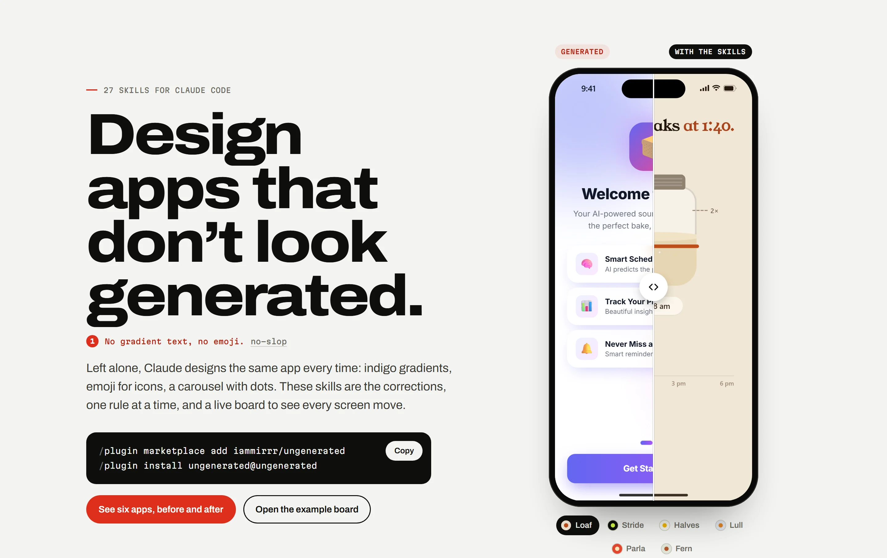
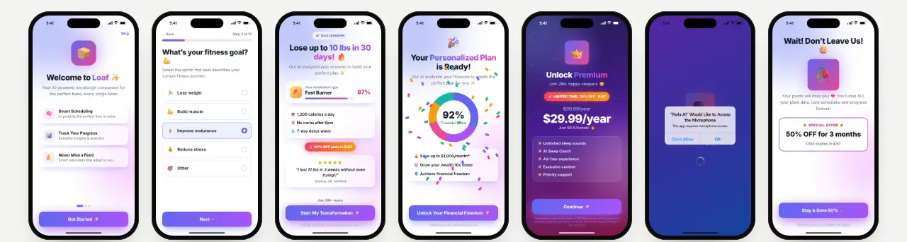
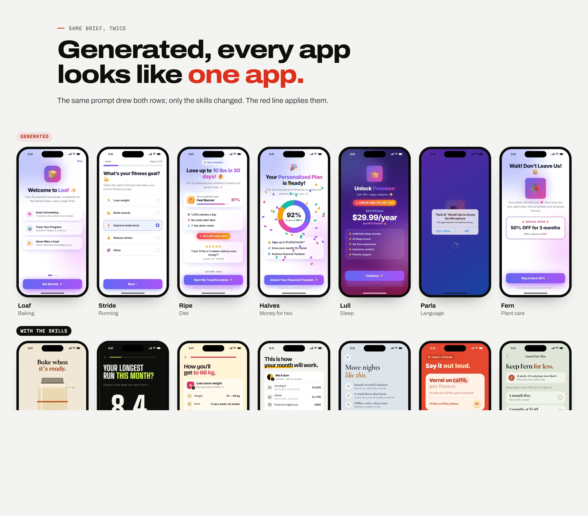
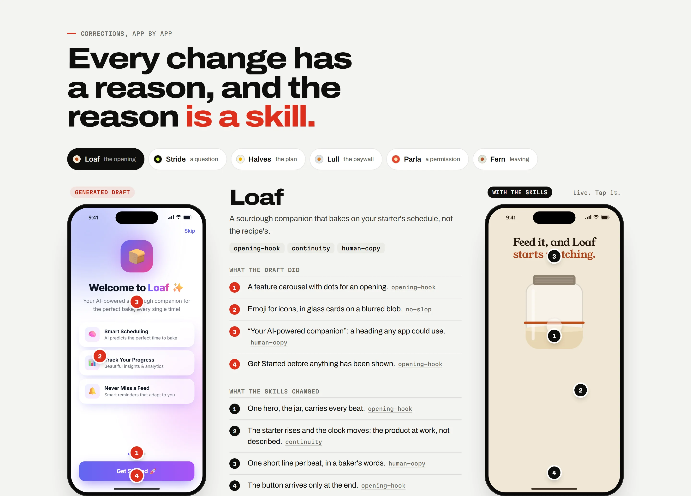
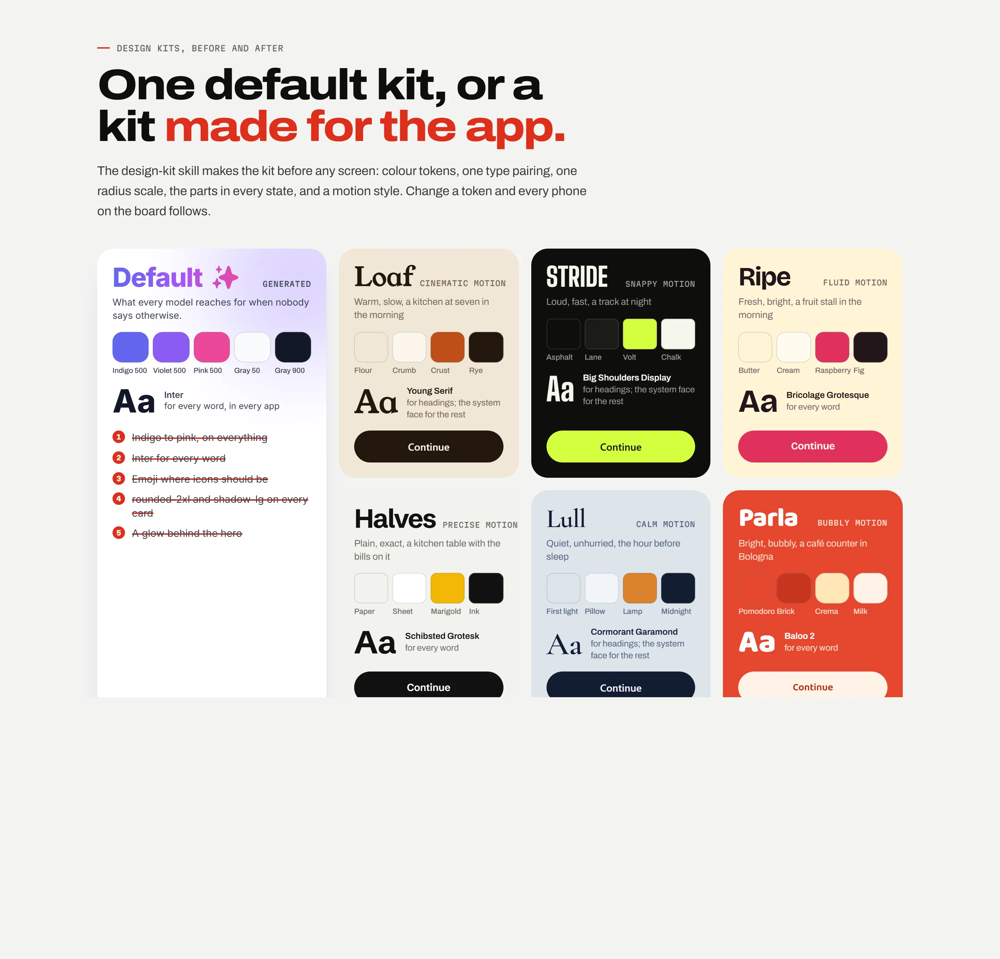
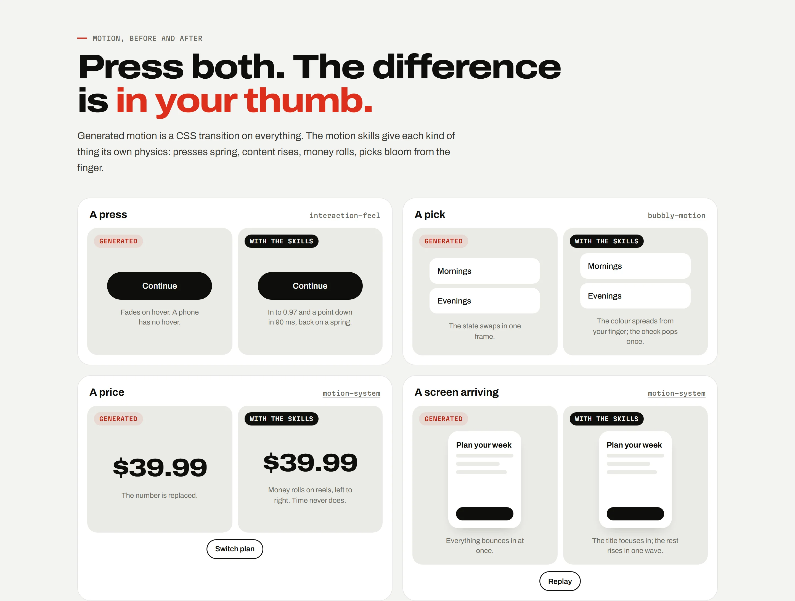
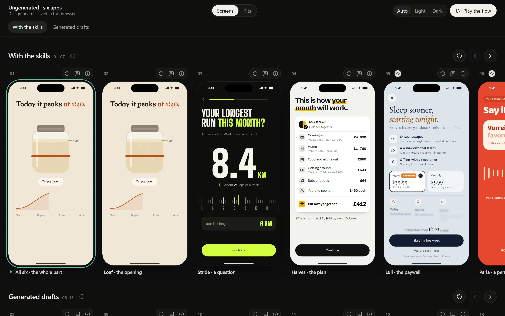

<a href="https://iammirrr.github.io/ungenerated/"></a>

# Ungenerated

Skills for designing mobile apps with Claude that don’t look generated: a live design board for
every screen, a design kit before any screen, motion with real physics, the onboarding, paywall
and cancel flows that work, and a checklist for the tells. They come from designing real apps
screen by screen with a demanding reviewer. Every rule in here was a correction once.

**[The page](https://iammirrr.github.io/ungenerated/)** · **[The example board](https://iammirrr.github.io/ungenerated/board/)** · [Install](#install) · [The skills](#the-skills)

## Same brief, twice



Six made-up apps, one step of each, drawn from the same brief twice: once with no skills loaded,
once with them. Generated, they share one default kit (indigo to pink, Inter, emoji, glass), so
six apps look like one. With the skills, each gets its own kit, its own motion and its own words.

| App | The step | Shaped by |
|---|---|---|
| **Loaf**, a sourdough companion | The opening | [`opening-hook`](skills/opening-hook/SKILL.md) · [`continuity`](skills/continuity/SKILL.md) · [`human-copy`](skills/human-copy/SKILL.md) |
| **Stride**, a running coach | A question | [`onboarding-questions`](skills/onboarding-questions/SKILL.md) · [`interaction-feel`](skills/interaction-feel/SKILL.md) · [`design-kit`](skills/design-kit/SKILL.md) |
| **Halves**, a budget for two | The plan | [`plan-reveal`](skills/plan-reveal/SKILL.md) · [`no-slop`](skills/no-slop/SKILL.md) · [`human-copy`](skills/human-copy/SKILL.md) |
| **Lull**, sleep sounds | The paywall | [`paywall`](skills/paywall/SKILL.md) · [`motion-system`](skills/motion-system/SKILL.md) · [`no-slop`](skills/no-slop/SKILL.md) |
| **Parla**, Italian out loud | A permission | [`consent-and-permissions`](skills/consent-and-permissions/SKILL.md) · [`bubbly-motion`](skills/bubbly-motion/SKILL.md) · [`human-copy`](skills/human-copy/SKILL.md) |
| **Fern**, plant care | Leaving | [`cancel-flow`](skills/cancel-flow/SKILL.md) · [`human-copy`](skills/human-copy/SKILL.md) · [`no-slop`](skills/no-slop/SKILL.md) |



Every phone here is a screenshot of a live screen on the [example board](https://iammirrr.github.io/ungenerated/board/),
where they play, react to your thumb and loop.

## Every change has a reason



On [the page](https://iammirrr.github.io/ungenerated/#apps), each app’s corrections are pinned to
both phones: what the draft did, what the skills changed, and the skill each change comes from.

## Design kits, before and after



[`design-kit`](skills/design-kit/SKILL.md) makes the kit before any screen: colour tokens, one type
pairing, one radius scale, the parts in every state. The six kits live in
[`examples/apps.json`](examples/apps.json); change a token there and the board, the page and these
pictures follow.

## Motion, before and after



Generated motion is one CSS transition on everything. The motion skills give each kind of thing
its own physics: presses spring, content rises, money rolls, picks bloom from the finger.
[Press them on the page.](https://iammirrr.github.io/ungenerated/#feel)

## Install

In Claude Code:

```
/plugin marketplace add iammirrr/ungenerated
/plugin install ungenerated@ungenerated
```

Or copy the folders you want from `skills/` into `~/.claude/skills/` (all projects) or
`.claude/skills/` (one project).

## Use

Start with “design the onboarding for my app” or “set up a design board”, and Claude follows
`app-design-workflow`: concept, research, kit, board, then the flow screen by screen, each checked
before you see it. You review on the board with Pick and Note; the next pass reads your notes.

## The skills

### Start here

| Skill | What it does |
|---|---|
| [`app-design-workflow`](skills/app-design-workflow/SKILL.md) | The order to design a mobile app in, and which skill to use at each step. |
| [`app-concept`](skills/app-concept/SKILL.md) | Define what an app is before designing it. |

### Foundation

| Skill | What it does |
|---|---|
| [`design-kit`](skills/design-kit/SKILL.md) | Build the design kit before any screen. |
| [`motion-system`](skills/motion-system/SKILL.md) | The motion rules and engine for app screens. |
| [`interaction-feel`](skills/interaction-feel/SKILL.md) | Make controls feel physical and fluid. |
| [`bubbly-motion`](skills/bubbly-motion/SKILL.md) | Give an app soft, bubbly, alive motion that still feels calm and expensive. |
| [`continuity`](skills/continuity/SKILL.md) | Make a flow feel like one continuous thing instead of a deck of screens. |
| [`real-icons-and-devices`](skills/real-icons-and-devices/SKILL.md) | Show real app icons and real-looking devices on design screens. |
| [`human-copy`](skills/human-copy/SKILL.md) | Write app copy that sounds like a person. |

### The board

| Skill | What it does |
|---|---|
| [`design-board`](skills/design-board/SKILL.md) | Scaffold and run a live design board for a mobile app. |
| [`app-research`](skills/app-research/SKILL.md) | Study how top apps structure a journey (onboarding, paywall, setup, a core screen) and turn it into "what we took" notes on the design board. |
| [`design-review`](skills/design-review/SKILL.md) | Run review passes with a reviewer. |
| [`visual-qa`](skills/visual-qa/SKILL.md) | Verify screens and motion with real screenshots before showing them. |

### The flow

| Skill | What it does |
|---|---|
| [`opening-hook`](skills/opening-hook/SKILL.md) | Design an app's opening. |
| [`onboarding-questions`](skills/onboarding-questions/SKILL.md) | Design onboarding questions that are quick and varied. |
| [`story-screens`](skills/story-screens/SKILL.md) | Design the story between the questions and the plan. |
| [`plan-reveal`](skills/plan-reveal/SKILL.md) | Show the person's answers becoming their plan. |
| [`account-signup`](skills/account-signup/SKILL.md) | Place and design the sign-up so it feels like saving progress, not a wall. |
| [`paywall`](skills/paywall/SKILL.md) | Design an honest, high-converting paywall. |
| [`consent-and-permissions`](skills/consent-and-permissions/SKILL.md) | Ask for consent and system permissions honestly and in context. |
| [`setup-and-tour`](skills/setup-and-tour/SKILL.md) | Design the first-run setup and tour. |
| [`app-screens`](skills/app-screens/SKILL.md) | Design the app's own screens after onboarding. |
| [`cancel-flow`](skills/cancel-flow/SKILL.md) | Design the cancel flow for a subscription app. |

### Quality

| Skill | What it does |
|---|---|
| [`no-slop`](skills/no-slop/SKILL.md) | The checklist every screen passes before anyone sees it. |
| [`accessibility-pass`](skills/accessibility-pass/SKILL.md) | Check app screens for accessibility before approval. |
| [`native-port`](skills/native-port/SKILL.md) | Build approved board screens natively in SwiftUI or Jetpack Compose. |
| [`board-to-app`](skills/board-to-app/SKILL.md) | Turn an approved board section into a working native demo that plays exactly like the board. |
| [`app-store-assets`](skills/app-store-assets/SKILL.md) | Make App Store and Play Store screenshots and the preview video from the design board. |

## The design board

<a href="https://iammirrr.github.io/ungenerated/board/"></a>

`skills/design-board/template/` is a working board: the motion engine, the parts (buttons, rows,
toggles, sliders, segmented controls, reels, coach marks), live bubbly and continuity demos, six
screen transitions, Play the flow, Pick and Note saved to the repo, and the tools that capture
real-time screenshots and contact sheets. Copy it into your project and run `node tools/serve.mjs`.
The [example board](https://iammirrr.github.io/ungenerated/board/) is that template running the six
apps from `examples/`.

## In this repository

| Folder | What is in it |
|---|---|
| `skills/` | The skills, one folder each, with a `SKILL.md` and any references or templates. |
| `examples/` | The six example apps: `apps.json` (their kits, notes and which skills shaped them), one screen file per app on the board engine, and the screenshots. |
| `site-src/` | The page and the skill pages. |
| `scripts/` | `build-site.mjs` builds the page and the board into `site/` (on every push); `shots.mjs` retakes the screenshots. |

## Contributing

Each skill is one folder with a `SKILL.md`. Keep them specific: a rule, why it holds, and what to do
instead. If a rule came from a real correction, it belongs here. The page rebuilds itself from the
skills on every push. If you change an example app, run `node scripts/build-site.mjs` and then
`node scripts/shots.mjs` so the pictures match.

## Licence

MIT for this repository. The icon subset in the board template is from Lucide (ISC). App icons are
not included: `tools/fetch-appicons.mjs` fetches them for your private use. The six example apps
are made up; any resemblance to a real app’s name is a coincidence.
