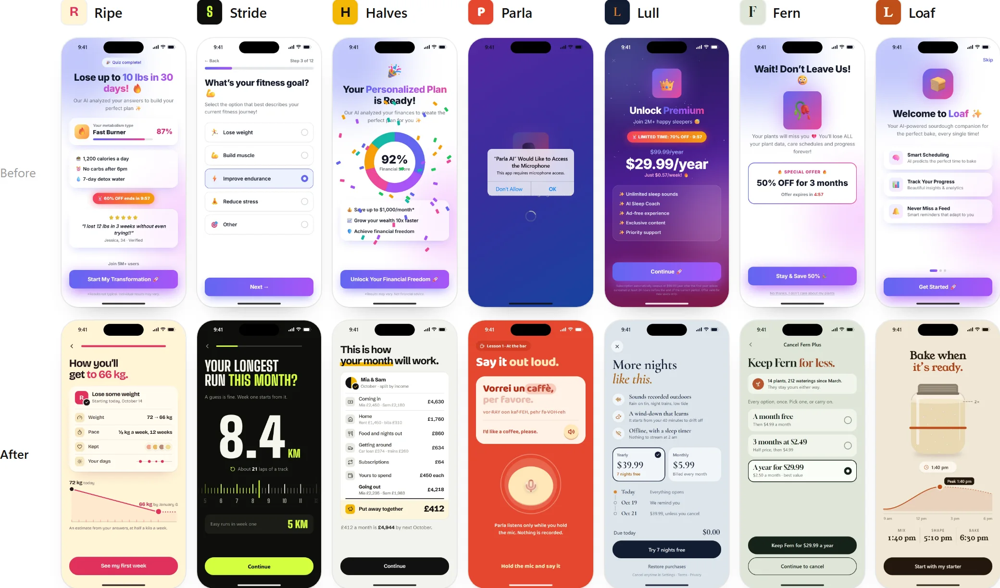
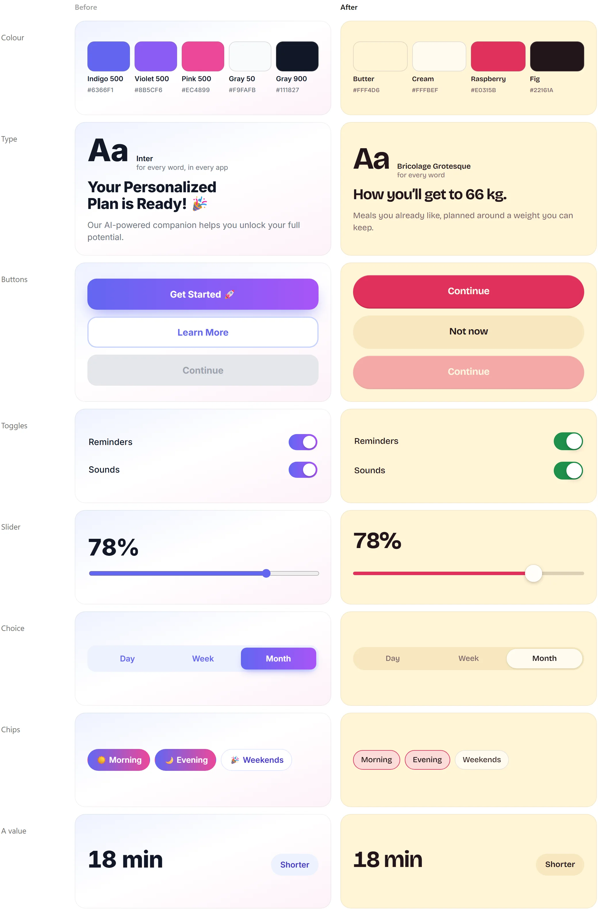
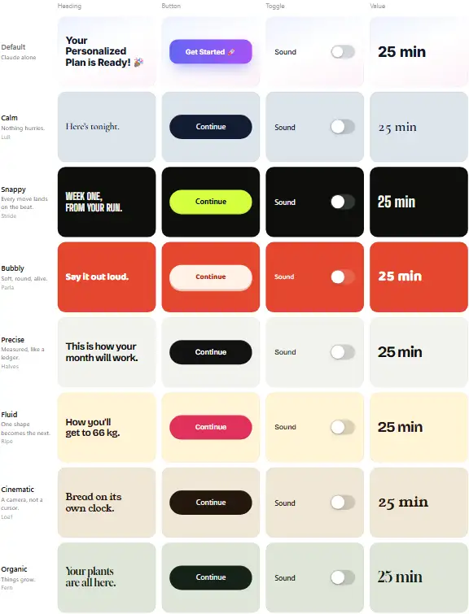

<a href="https://iammirrr.github.io/ungenerated/"></a>

# Ungenerated

Design skills for Claude Code, for mobile apps that don’t look generated.

**[See the projects](https://iammirrr.github.io/ungenerated/)** · [Install](#install) · [The skills](#the-skills)

## Same brief, twice



Above, Claude alone: seven apps that look like one. Below, the same seven with the skills.

## Seven projects

Each project page plays every flow live, shows the kit part by part, and gives the ChatGPT prompts
for its pictures.

| Project | | Motion | Flows |
|---|---|---|---|
| [Ripe](https://iammirrr.github.io/ungenerated/projects/ripe.html) | Diet | Fluid | Questions to a plan, the paywall |
| [Stride](https://iammirrr.github.io/ungenerated/projects/stride.html) | Running | Snappy | The opening, questions to week one, the paywall |
| [Halves](https://iammirrr.github.io/ungenerated/projects/halves.html) | Money for two | Precise | Questions to the month, leaving |
| [Parla](https://iammirrr.github.io/ungenerated/projects/parla.html) | Language | Bubbly | The opening, the microphone, leaving |
| [Lull](https://iammirrr.github.io/ungenerated/projects/lull.html) | Sleep | Calm | The paywall |
| [Fern](https://iammirrr.github.io/ungenerated/projects/fern.html) | Plant care | Organic | The first plant, leaving |
| [Loaf](https://iammirrr.github.io/ungenerated/projects/loaf.html) | Baking | Cinematic | The opening, the first bake |


Three paywalls: Lull, Ripe, Stride.


Three ways out: Fern, Halves, Parla.


Three openings: Stride, Parla, Loaf.

## The kit, part by part



Left, the kit Claude uses for every app. Right, Ripe’s, made by [`design-kit`](skills/design-kit/SKILL.md)
before any screen.

## Seven ways to move



[`motion-styles`](skills/motion-styles/SKILL.md): one line on the board, `style: 'calm'`, and every
heading, press, toggle and value moves that way.

## Install

In Claude Code:

```
/plugin marketplace add iammirrr/ungenerated
/plugin install ungenerated@ungenerated
```

Or copy the folders you want from `skills/` into `~/.claude/skills/` (all projects) or
`.claude/skills/` (one project). Then ask for “the paywall for my sleep app” or “a design board”,
and Claude follows `app-design-workflow`.

## The skills

### Start here

| Skill | What it does |
|---|---|
| [`app-design-workflow`](skills/app-design-workflow/SKILL.md) | The order to design a mobile app in, and which skill to use at each step. |
| [`app-concept`](skills/app-concept/SKILL.md) | Define what an app is before designing it. |

### Foundation

| Skill | What it does |
|---|---|
| [`design-kit`](skills/design-kit/SKILL.md) | Build the design kit before any screen. |
| [`motion-system`](skills/motion-system/SKILL.md) | The motion rules and engine for app screens. |
| [`motion-styles`](skills/motion-styles/SKILL.md) | Give an app its own motion personality: calm, snappy, bubbly, precise, fluid, cinematic or organic. |
| [`interaction-feel`](skills/interaction-feel/SKILL.md) | Make controls feel physical and fluid. |
| [`bubbly-motion`](skills/bubbly-motion/SKILL.md) | Soft, bubbly, alive motion that still feels calm and expensive. |
| [`continuity`](skills/continuity/SKILL.md) | Make a flow feel like one continuous thing instead of a deck of screens. |
| [`real-icons-and-devices`](skills/real-icons-and-devices/SKILL.md) | Show real app icons and real-looking devices on design screens. |
| [`human-copy`](skills/human-copy/SKILL.md) | Write app copy that sounds like a person. |

### The board

| Skill | What it does |
|---|---|
| [`design-board`](skills/design-board/SKILL.md) | Scaffold and run a live design board for a mobile app. |
| [`app-research`](skills/app-research/SKILL.md) | Study how top apps structure a journey and turn it into "what we took" notes on the board. |
| [`design-review`](skills/design-review/SKILL.md) | Run review passes with a reviewer. |
| [`visual-qa`](skills/visual-qa/SKILL.md) | Verify screens and motion with real screenshots before showing them. |

### The flow

| Skill | What it does |
|---|---|
| [`opening-hook`](skills/opening-hook/SKILL.md) | Design an app's opening. |
| [`onboarding-questions`](skills/onboarding-questions/SKILL.md) | Design onboarding questions that are quick and varied. |
| [`story-screens`](skills/story-screens/SKILL.md) | Design the story between the questions and the plan. |
| [`plan-reveal`](skills/plan-reveal/SKILL.md) | Show the person's answers becoming their plan. |
| [`account-signup`](skills/account-signup/SKILL.md) | Place and design the sign-up so it feels like saving progress, not a wall. |
| [`paywall`](skills/paywall/SKILL.md) | Design an honest, high-converting paywall. |
| [`consent-and-permissions`](skills/consent-and-permissions/SKILL.md) | Ask for consent and system permissions honestly and in context. |
| [`setup-and-tour`](skills/setup-and-tour/SKILL.md) | Design the first-run setup and tour. |
| [`app-screens`](skills/app-screens/SKILL.md) | Design the app's own screens after onboarding. |
| [`cancel-flow`](skills/cancel-flow/SKILL.md) | Design the cancel flow for a subscription app. |

### Quality

| Skill | What it does |
|---|---|
| [`no-slop`](skills/no-slop/SKILL.md) | The checklist every screen passes before anyone sees it. |
| [`accessibility-pass`](skills/accessibility-pass/SKILL.md) | Check app screens for accessibility before approval. |
| [`native-port`](skills/native-port/SKILL.md) | Build approved board screens natively in SwiftUI or Jetpack Compose. |
| [`board-to-app`](skills/board-to-app/SKILL.md) | Turn an approved board section into a working native demo that plays exactly like the board. |
| [`app-store-assets`](skills/app-store-assets/SKILL.md) | Make App Store and Play Store screenshots and the preview video from the design board. |

## The design board

<a href="https://iammirrr.github.io/ungenerated/board/"></a>

`skills/design-board/template/` is a working board: every screen a live phone, the motion engine
and its seven styles, the parts, Play the flow, and Pick and Note for review. Copy it into your
project and run `node tools/serve.mjs`. The
[example board](https://iammirrr.github.io/ungenerated/board/) runs the seven projects.

## In this repository

| Folder | What is in it |
|---|---|
| `skills/` | The skills, one folder each, with a `SKILL.md` and any references or templates. |
| `examples/` | The seven projects: kits and motion styles (`apps.json`), flows (`flows.json`), pictures (`images.json`), and their screens on the board engine. |
| `site-src/` | The site: the home page, the project pages and the skill pages. |
| `scripts/` | `build-site.mjs` builds the site into `site/` on every push; `dev.mjs` serves the board while you work; `shots.mjs` retakes the screenshots; `images.mjs` turns pictures into light WebP files. |

The pictures (the mascot, the food, the plants, the app icons) come from ChatGPT:
[`examples/IMAGE-PROMPTS.md`](examples/IMAGE-PROMPTS.md) is a brief to upload to a chat, and it
makes them one by one. Until one exists, the screens show a placeholder.

## Contributing

Each skill is one folder with a `SKILL.md`: a rule, why it holds, and what to do instead. If you
change an example, run `node scripts/build-site.mjs`, then `node scripts/shots.mjs`.

## Licence

MIT. The icon subset in the board template is from Lucide (ISC). App icons are not included:
`tools/fetch-appicons.mjs` fetches them for your private use. The seven projects are made up.
