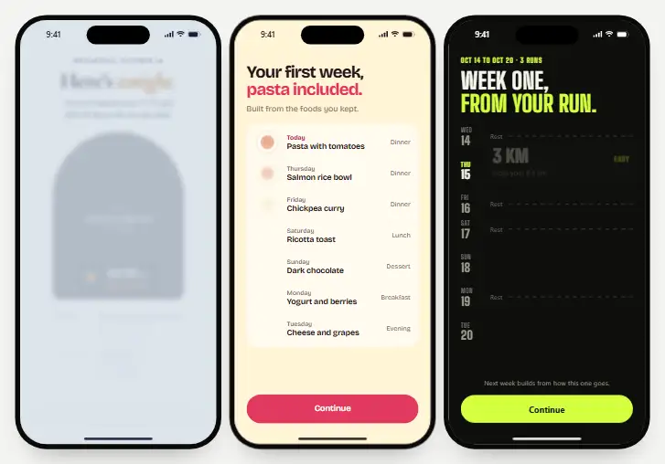
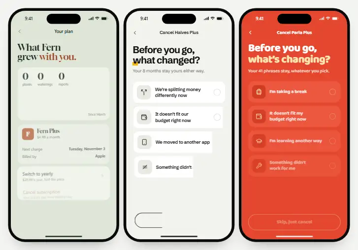
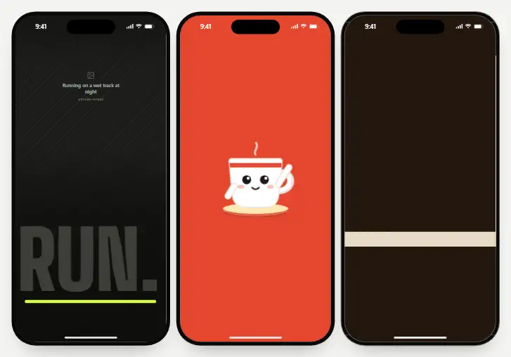
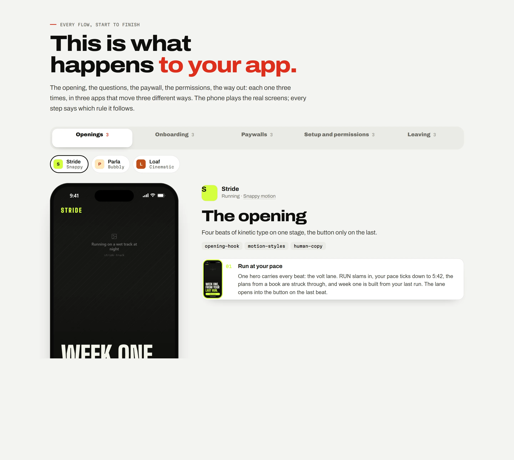
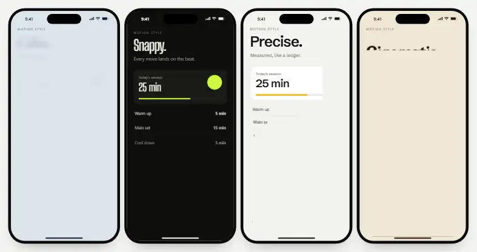

<a href="https://iammirrr.github.io/ungenerated/"></a>

# Ungenerated

Left alone, Claude designs the same app every time: indigo gradients, emoji for icons, one bounce
for everything. These skills are the corrections: a live design board for every screen, a design
kit and a motion style before any screen, the onboarding, paywall and cancel flows that work, and a
checklist for the tells. They come from designing real apps screen by screen with a demanding
reviewer. Every rule in here was a correction once.

**[The page](https://iammirrr.github.io/ungenerated/)** · **[The example board](https://iammirrr.github.io/ungenerated/board/)** · [Install](#install) · [The skills](#the-skills)

## This is what happens to your app

Seven made-up apps, fifteen full flows, every screen live. Each kind of flow is shown three times,
in three apps that look and move three different ways.



**Paywalls.** Lull (calm), Ripe (fluid), Stride (snappy). One value beat made from the person’s own
answers, every price before any tap, the trial on a timeline with real dates, one button, and then
the permission the trial promised, asked in context.



**Leaving.** One question, three answers, three different screens. Budget gets the whole menu once
(Fern). Someone who moved to another app gets their data and no offer (Halves). A break gets the
honest version the App Store allows: renewal off, everything kept, a reminder (Parla).



**Openings.** Kinetic type on the beat (Stride), a mascot and a microphone you hold (Parla), a
camera that moves from the crumb to the jar (Loaf). The button arrives on the last beat.

| Kind | The apps (steps) | Shaped by |
|---|---|---|
| Openings | Stride, Parla, Loaf | [`opening-hook`](skills/opening-hook/SKILL.md), [`continuity`](skills/continuity/SKILL.md) |
| Onboarding | Ripe (5), Stride (4), Halves (4) | [`onboarding-questions`](skills/onboarding-questions/SKILL.md), [`plan-reveal`](skills/plan-reveal/SKILL.md) |
| Paywalls | Lull (4), Ripe (3), Stride (3) | [`paywall`](skills/paywall/SKILL.md), [`consent-and-permissions`](skills/consent-and-permissions/SKILL.md) |
| Setup and permissions | Parla (3), Fern (3), Loaf (3) | [`setup-and-tour`](skills/setup-and-tour/SKILL.md), [`consent-and-permissions`](skills/consent-and-permissions/SKILL.md) |
| Leaving | Fern (7), Halves (3), Parla (3) | [`cancel-flow`](skills/cancel-flow/SKILL.md), [`human-copy`](skills/human-copy/SKILL.md) |

<a href="https://iammirrr.github.io/ungenerated/#flows"></a>

On [the page](https://iammirrr.github.io/ungenerated/#flows), a live phone plays each flow step by
step, and every step says what it does and which rule it follows. Each skill’s own page plays the
flows that show it at work.

## Seven ways to move



Generated motion is one bounce for everything. [`motion-styles`](skills/motion-styles/SKILL.md)
gives an app a personality instead, and one line on the board (`style: 'calm'`) moves every
heading, list, press, value and screen change in it.

| Style | It feels | Use for | Seen in |
|---|---|---|---|
| Calm | Nothing hurries. | sleep, meditation, health, journaling | Lull |
| Snappy | Every move lands on the beat. | fitness, sport, games, music | Stride |
| Bubbly | Soft, round, alive. | language, kids, habits, social | Parla |
| Precise | Measured, like a ledger. | money, productivity, tools | Halves |
| Fluid | One shape becomes the next. | diet, health tracking, utilities | Ripe |
| Cinematic | A camera, not a cursor. | food, travel, reading, fashion | Loaf |
| Organic | Things grow. | plants, gardening, wellbeing, nature | Fern |

## Same brief, twice


The same prompt drew both rows; only the skills changed. Generated, every app shares one default
kit (indigo to pink, Inter, emoji, glass), so seven apps look like one. With the skills, each gets
its own kit, its own motion and its own words.


## Design kits, before and after


[`design-kit`](skills/design-kit/SKILL.md) makes the kit before any screen: colour tokens, one type
pairing, one radius scale, the parts in every state, and the motion style. The kits live in
[`examples/apps.json`](examples/apps.json); change a token there and the board, the page and these
pictures follow.

## Install

In Claude Code:

```
/plugin marketplace add iammirrr/ungenerated
/plugin install ungenerated@ungenerated
```

Or copy the folders you want from `skills/` into `~/.claude/skills/` (all projects) or
`.claude/skills/` (one project).

## Use

Start with “design the paywall for my sleep app” or “set up a design board”, and Claude follows
`app-design-workflow`: concept, research, kit and motion style, board, then the flow screen by
screen, each checked before you see it. You review on the board with Pick and Note; the next pass
reads your notes.

## The skills

### Start here

| Skill | What it does |
|---|---|
| [`app-design-workflow`](skills/app-design-workflow/SKILL.md) | The order to design a mobile app in, and which skill to use at each step. |
| [`app-concept`](skills/app-concept/SKILL.md) | Define what an app is before designing it. |

### Foundation

| Skill | What it does |
|---|---|
| [`design-kit`](skills/design-kit/SKILL.md) | Build the design kit before any screen. |
| [`motion-system`](skills/motion-system/SKILL.md) | The motion rules and engine for app screens. |
| [`motion-styles`](skills/motion-styles/SKILL.md) | Give an app its own motion personality: calm, snappy, bubbly, precise, fluid, cinematic or organic. |
| [`interaction-feel`](skills/interaction-feel/SKILL.md) | Make controls feel physical and fluid. |
| [`bubbly-motion`](skills/bubbly-motion/SKILL.md) | Soft, bubbly, alive motion that still feels calm and expensive. |
| [`continuity`](skills/continuity/SKILL.md) | Make a flow feel like one continuous thing instead of a deck of screens. |
| [`real-icons-and-devices`](skills/real-icons-and-devices/SKILL.md) | Show real app icons and real-looking devices on design screens. |
| [`human-copy`](skills/human-copy/SKILL.md) | Write app copy that sounds like a person. |

### The board

| Skill | What it does |
|---|---|
| [`design-board`](skills/design-board/SKILL.md) | Scaffold and run a live design board for a mobile app. |
| [`app-research`](skills/app-research/SKILL.md) | Study how top apps structure a journey and turn it into "what we took" notes on the board. |
| [`design-review`](skills/design-review/SKILL.md) | Run review passes with a reviewer. |
| [`visual-qa`](skills/visual-qa/SKILL.md) | Verify screens and motion with real screenshots before showing them. |

### The flow

| Skill | What it does |
|---|---|
| [`opening-hook`](skills/opening-hook/SKILL.md) | Design an app's opening. |
| [`onboarding-questions`](skills/onboarding-questions/SKILL.md) | Design onboarding questions that are quick and varied. |
| [`story-screens`](skills/story-screens/SKILL.md) | Design the story between the questions and the plan. |
| [`plan-reveal`](skills/plan-reveal/SKILL.md) | Show the person's answers becoming their plan. |
| [`account-signup`](skills/account-signup/SKILL.md) | Place and design the sign-up so it feels like saving progress, not a wall. |
| [`paywall`](skills/paywall/SKILL.md) | Design an honest, high-converting paywall. |
| [`consent-and-permissions`](skills/consent-and-permissions/SKILL.md) | Ask for consent and system permissions honestly and in context. |
| [`setup-and-tour`](skills/setup-and-tour/SKILL.md) | Design the first-run setup and tour. |
| [`app-screens`](skills/app-screens/SKILL.md) | Design the app's own screens after onboarding. |
| [`cancel-flow`](skills/cancel-flow/SKILL.md) | Design the cancel flow for a subscription app. |

### Quality

| Skill | What it does |
|---|---|
| [`no-slop`](skills/no-slop/SKILL.md) | The checklist every screen passes before anyone sees it. |
| [`accessibility-pass`](skills/accessibility-pass/SKILL.md) | Check app screens for accessibility before approval. |
| [`native-port`](skills/native-port/SKILL.md) | Build approved board screens natively in SwiftUI or Jetpack Compose. |
| [`board-to-app`](skills/board-to-app/SKILL.md) | Turn an approved board section into a working native demo that plays exactly like the board. |
| [`app-store-assets`](skills/app-store-assets/SKILL.md) | Make App Store and Play Store screenshots and the preview video from the design board. |

## The design board

<a href="https://iammirrr.github.io/ungenerated/board/"></a>

`skills/design-board/template/` is a working board: the motion engine with its seven styles, the
parts (buttons, rows, toggles, sliders, segmented controls, reels, coach marks), screen
transitions, Play the flow, Pick and Note saved to the repo, and the tools that capture real-time
screenshots. Copy it into your project and run `node tools/serve.mjs`. The
[example board](https://iammirrr.github.io/ungenerated/board/) is that template running the seven
apps from `examples/`.

## In this repository

| Folder | What is in it |
|---|---|
| `skills/` | The skills, one folder each, with a `SKILL.md` and any references or templates. |
| `examples/` | The seven example apps: their kits and motion styles (`apps.json`), their fifteen flows (`flows.json`), the pictures they use (`images.json`), one screen file per app on the board engine, and the screenshots. |
| `site-src/` | The page, the flow player and the skill pages. |
| `scripts/` | `build-site.mjs` builds the page and the board into `site/` on every push; `dev.mjs` serves the board live while you work; `shots.mjs` retakes the screenshots and recordings; `images.mjs` turns pictures into light WebP files. |

The pictures (the mascot, the food, the plants, the app icons) are made from the prompts in
[`examples/IMAGE-PROMPTS.md`](examples/IMAGE-PROMPTS.md). Until a picture exists, the screens show
a labelled placeholder in its place.

## Contributing

Each skill is one folder with a `SKILL.md`. Keep them specific: a rule, why it holds, and what to do
instead. If a rule came from a real correction, it belongs here. The page rebuilds itself from the
skills on every push. If you change an example app, run `node scripts/build-site.mjs` and then
`node scripts/shots.mjs` so the pictures match.

## Licence

MIT for this repository. The icon subset in the board template is from Lucide (ISC). App icons are
not included: `tools/fetch-appicons.mjs` fetches them for your private use. The seven example apps
are made up; any resemblance to a real app’s name is a coincidence.
